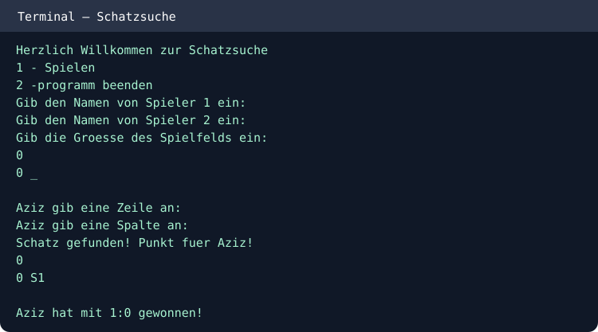

# Treasure Hunt — Schatzsuche (Java)
A two-player Java console game. Find hidden treasures on a random square grid and collect points.

## Play
```bash
javac -d out src/*.java
java -cp out Spiel
```
Choose 1, enter two player names and a grid size (1–20). Players alternate selecting row and column indices (starting at zero). Finding a treasure earns a point and another turn. Question marks indicate an adjacent treasure.

## Features
- Random treasure placement
- Turn-based play and score keeping
- Hints for nearby treasures
- Input range checks

## Console example
